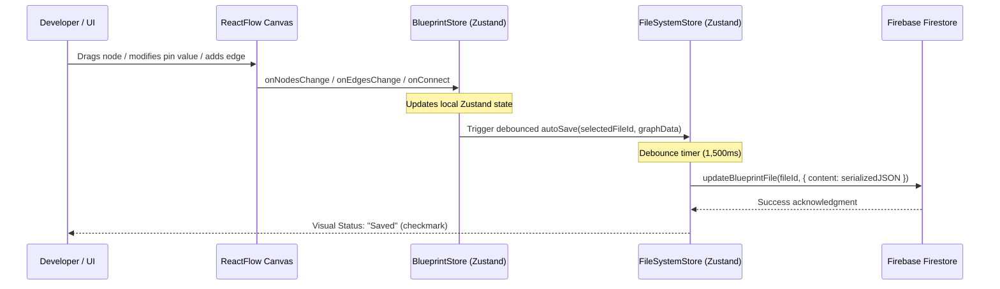

# Technical Specification: Persistence, State Management & Auto-Save Overhaul

**Document ID:** `DOC-02-PERSISTENCE-STATE`  
**Target Codebase Files:**
* `src/store/fileSystemStore.ts` (Store logic, hierarchy & saving)
* `src/components/BlueprintEditor.tsx` (Removing duplicate code, wiring auto-save)
* `src/components/FileExplorer.tsx` (Component interface alignment)
* `src/services/firestore.ts` (Type contracts, schema updates)

---

## 1. Problem Statement

Data persistence in Noder is currently broken in multiple places:
1. **The Save Button is an Empty Mockup**: In [BlueprintEditor.tsx#L321](file:///d:/noder/src/components/BlueprintEditor.tsx#L321), clicking "Save" calls `BlueprintGenerationService.saveAsTemplate()`, which contains no database code and simply outputs a `console.log`.
2. **Edits Are Never Saved**: While [fileSystemStore.ts#L67](file:///d:/noder/src/store/fileSystemStore.ts#L67) defines `updateFile(fileId, data)`, it is **never called anywhere in `BlueprintEditor.tsx`**. If a user drags nodes, edits values, or adds connections, all changes remain in transient React state. Switching files or reloading the browser discards the changes completely.
3. **Severe Code Duplication in `BlueprintEditor.tsx`**:
   `BlueprintEditor.tsx` (1,008 lines) imports [FileExplorer.tsx](file:///d:/noder/src/components/FileExplorer.tsx), but also contains over 150 lines of duplicate, obsolete file-tree states:
   * `fileSystem` state on line 83.
   * `newItemName`, `isCreatingFile`, `isCreatingFolder`, `editingParentId` states on lines 84-87.
   * Duplicate file creation methods on lines 397-456.
   * An obsolete recursive renderer `renderFileSystem` on lines 670-750 referencing non-existent `item.childrenObjects`.
4. **TypeScript Model Discrepancies**:
   In `fileSystemStore.ts`, `buildFileTree` dynamically assigns `parent.childrenObjects = []`, but `childrenObjects` is omitted from the `BlueprintFile` interface in `firestore.ts`, causing compiler errors.

---

## 2. Target Persistence Architecture



---

## 3. Concrete Implementation Steps

### Step 1: Update Data Contracts in `src/services/firestore.ts`
Add the missing UI-hierarchy properties to `BlueprintFile`:

```typescript
export interface BlueprintFile {
  id?: string;
  name: string;
  content: string; // Serialized JSON { nodes, edges, blueprintName, description }
  type: 'file' | 'folder';
  projectId: string;
  parentId?: string | null;
  children?: string[]; // IDs for Firestore document tracking
  childrenObjects?: BlueprintFile[]; // Computed tree hierarchy for UI rendering
  isOpen?: boolean;
  path?: string;
  createdAt?: Timestamp;
  updatedAt?: Timestamp;
  userId: string;
}
```

### Step 2: Implement Real Template Saving in `src/services/firestore.ts`
Add dedicated collection methods for templates:

```typescript
export const COLLECTIONS = {
  USERS: 'users',
  PROJECTS: 'projects',
  BLUEPRINTS: 'blueprints',
  FILES: 'files',
  TEMPLATES: 'templates' // New collection
};

export interface BlueprintTemplateDocument {
  id?: string;
  name: string;
  description: string;
  content: string;
  category: string;
  userId: string;
  createdAt: Timestamp;
}

export const saveBlueprintTemplate = async (
  template: Omit<BlueprintTemplateDocument, 'id' | 'createdAt'>
): Promise<string> => {
  const docRef = await addDoc(collection(firestore, COLLECTIONS.TEMPLATES), {
    ...template,
    createdAt: serverTimestamp()
  });
  return docRef.id;
};
```

Update [BlueprintGenerationService.ts](file:///d:/noder/src/services/blueprintGenerationService.ts#L103) to call `saveBlueprintTemplate`:

```typescript
static async saveAsTemplate(blueprint: any, name: string, description: string, userId: string): Promise<string> {
  return await saveBlueprintTemplate({
    name: name || 'Untitled Template',
    description: description || '',
    content: JSON.stringify(blueprint),
    category: 'custom',
    userId
  });
}
```

---

### Step 3: Implement Debounced Auto-Save in `src/store/fileSystemStore.ts`

Add an auto-save action with a debounce timer:

```typescript
interface FileSystemState {
  // Existing state...
  isSaving: boolean;
  lastSavedAt: Date | null;
  saveError: string | null;

  saveCurrentFileContent: (fileId: string, content: string) => Promise<void>;
  debouncedSaveContent: (fileId: string, content: string) => void;
}

let saveTimeout: NodeJS.Timeout | null = null;

// Inside create<FileSystemState>:
saveCurrentFileContent: async (fileId: string, content: string) => {
  try {
    set({ isSaving: true, saveError: null });
    await updateBlueprintFile(fileId, { content });
    
    // Update local store state to keep files in sync
    const files = get().files.map(f => f.id === fileId ? { ...f, content } : f);
    set({ files, isSaving: false, lastSavedAt: new Date() });
  } catch (err: any) {
    console.error("Auto-save failed:", err);
    set({ isSaving: false, saveError: err.message || "Failed to save" });
  }
},

debouncedSaveContent: (fileId: string, content: string) => {
  if (saveTimeout) clearTimeout(saveTimeout);
  set({ isSaving: true });

  saveTimeout = setTimeout(() => {
    get().saveCurrentFileContent(fileId, content);
  }, 1500); // 1.5 second debounce
}
```

---

### Step 4: Refactor `src/components/BlueprintEditor.tsx`

1. **Delete Dead Code**:
   * Delete lines 83-87 (`fileSystem`, `newItemName`, `isCreatingFile`, `isCreatingFolder`, `editingParentId`).
   * Delete lines 397-456 (`handleCreateItem`, `handleCancelCreate`, `handleSaveItem`).
   * Delete lines 670-750 (the entire obsolete `renderFileSystem` function).
2. **Hook Canvas Changes to Auto-Save**:
   Whenever `nodes` or `edges` mutate in the editor, trigger `debouncedSaveContent`:

```typescript
const { currentSelectedFileId, debouncedSaveContent, isSaving, lastSavedAt } = useFileSystemStore();

// Watch for node / edge updates and auto-save to currently selected file
useEffect(() => {
  if (!currentSelectedFileId || nodes.length === 0) return;

  const serializedContent = JSON.stringify({
    name: blueprintName,
    description: blueprintDescription,
    nodes,
    edges
  }, null, 2);

  debouncedSaveContent(currentSelectedFileId, serializedContent);
}, [nodes, edges, blueprintName, blueprintDescription, currentSelectedFileId, debouncedSaveContent]);
```

3. **Render Real Save Status Indicator**:
   In the editor toolbar, replace static buttons with a dynamic status badge:
   ```tsx
   <div className="flex items-center space-x-2 text-xs text-gray-400">
     {isSaving ? (
       <>
         <LuLoader className="w-3.5 h-3.5 animate-spin text-blue-400" />
         <span>Saving...</span>
       </>
     ) : lastSavedAt ? (
       <>
         <LuCheck className="w-3.5 h-3.5 text-green-400" />
         <span>Saved {lastSavedAt.toLocaleTimeString()}</span>
       </>
     ) : null}
   </div>
   ```

---

## 4. Verification Protocol

1. **Auto-Save Test**:
   * Open a project and create a new file `TestSprint.ueblueprint`.
   * Drag a node to position `(500, 300)`.
   * Verify that the indicator shows "Saving..." and switches to "Saved".
   * Refresh the browser.
   * Verify that the node restores at `(500, 300)` with zero data loss.
2. **File Switch Test**:
   * Switch between File A and File B.
   * Ensure changes to File A are flushed before File B loads.
   * Verify canvas cleanly resets and populates File B's graph without ghost nodes from File A.
3. **Template Creation Test**:
   * Click "Save as Template".
   * Verify a document is created in Firestore under the `templates` collection with complete node and edge payloads.

