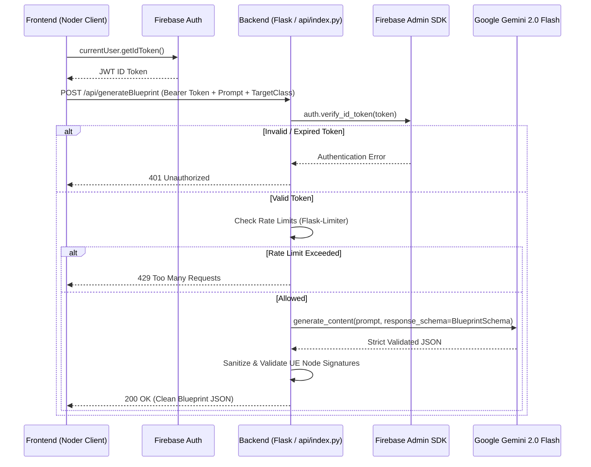

# Technical Specification: Backend Security, API Hardening & AI Generation Engine

**Document ID:** `DOC-03-BACKEND-AI-PIPELINE`  
**Target Codebase Files:**
* `api/index.py` (Flask handler, auth, schema)
* `api/requirements.txt` (Python dependencies)
* `src/services/blueprintGenerationService.ts` (Frontend service token forwarding)
* `src/hooks/useBlueprint.ts` (Graph generation flow)

---

## 1. Problem Statement

The backend API represents a major financial, security, and architectural vulnerability:
1. **Zero Endpoint Authentication**:
   In [api/index.py#L178](file:///d:/noder/api/index.py#L178), the route `/api/generateBlueprint` accepts incoming POST requests without checking for an authenticated user session. Anyone who discovers the URL can send queries and drain the project's Gemini API quota, causing billing spikes.
2. **Missing Rate Limiting**:
   There are no safeguards against denial-of-service or automated scraping.
3. **Fragile AI Output Extraction**:
   [api/index.py#L213-L223](file:///d:/noder/api/index.py#L213-L223) uses regular expressions to find ````json blocks or curly braces. If the LLM generates conversational text or incomplete markdown, parsing fails and returns a 500 error.
4. **Lack of Gemini Structured Outputs**:
   The current code instructs the model via prompt prose to output JSON. Google's `google-generativeai` SDK supports native **Structured Outputs** (`response_schema` / `response_mime_type="application/json"`), which guarantees that responses conform strictly to the specified schema without regex.
5. **No Context or Class Awareness**:
   The prompt treats all blueprints generically. It cannot distinguish between an `Actor`, a `Character` (with movement components), or a `UserWidget`.

---

## 2. Hardened Architecture Design



---

## 3. Concrete Implementation Steps

### Step 1: Update `api/requirements.txt`
Add `firebase-admin` and `Flask-Limiter`:

```text
Flask>=3.0.0
Flask-Cors>=4.0.0
google-generativeai>=0.8.0
python-dotenv>=1.0.0
gunicorn>=21.2.0
Werkzeug>=3.0.0
firebase-admin>=6.4.0
Flask-Limiter>=3.5.0
pydantic>=2.5.0
```

---

### Step 2: Implement Firebase ID Token Verification & Rate Limiting in `api/index.py`

Initialize Firebase Admin and create an authentication decorator:

```python
import os
import functools
import firebase_admin
from firebase_admin import auth as firebase_auth, credentials
from flask import Flask, request, jsonify, g
from flask_limiter import Limiter
from flask_limiter.util import get_remote_address

app = Flask(__name__)

# Initialize Firebase Admin
if not firebase_admin._apps:
    # Use application default credentials or credentials from env variable
    cred_json = os.getenv("FIREBASE_SERVICE_ACCOUNT_JSON")
    if cred_json:
        import json
        cred_dict = json.loads(cred_json)
        cred = credentials.Certificate(cred_dict)
        firebase_admin.initialize_app(cred)
    else:
        # Fallback to default credentials for cloud environments
        firebase_admin.initialize_app()

# Initialize Rate Limiter: max 30 requests per minute per user/IP
limiter = Limiter(
    get_remote_address,
    app=app,
    default_limits=["120 per hour"],
    storage_uri="memory://"
)

def require_auth(f):
    @functools.wraps(f)
    def decorated_function(*args, **kwargs):
        auth_header = request.headers.get('Authorization')
        if not auth_header or not auth_header.startswith('Bearer '):
            return jsonify({"error": "Missing or malformed Authorization header"}), 401
        
        token = auth_header.split(' ')[1]
        try:
            decoded_token = firebase_auth.verify_id_token(token)
            g.user_id = decoded_token['uid']
            g.user_email = decoded_token.get('email', '')
        except Exception as e:
            return jsonify({"error": f"Invalid authentication token: {str(e)}"}), 401
            
        return f(*args, **kwargs)
    return decorated_function
```

---

### Step 3: Implement Gemini Native Structured Outputs

Define Pydantic schema contracts for Gemini generation:

```python
from pydantic import BaseModel, Field
from typing import List, Optional, Literal

class PinSchema(BaseModel):
    name: str = Field(description="Exact pin name in Unreal Engine (e.g. Execute, InString, ReturnValue)")
    type: Literal['exec', 'bool', 'float', 'int', 'string', 'vector', 'object', 'wildcard']
    value: Optional[str] = Field(default=None, description="Default value if pin is an unconnected input")

class NodeSchema(BaseModel):
    id: str = Field(description="Unique temporary ID within graph, e.g. node-1")
    title: str = Field(description="Exact Unreal Engine node function or event title")
    nodeType: Literal['event', 'function', 'variable', 'macro']
    color: Optional[str] = Field(default="#1E88E5", description="Hex color matching UE5 node header")
    inputs: List[PinSchema]
    outputs: List[PinSchema]

class ConnectionSchema(BaseModel):
    sourceNodeId: str
    sourcePinName: str
    targetNodeId: str
    targetPinName: str

class BlueprintGraphSchema(BaseModel):
    blueprintName: str
    blueprintDescription: str
    nodes: List[NodeSchema]
    connections: List[ConnectionSchema]
```

Configure Gemini with `generation_config`:

```python
generation_config = {
    "temperature": 0.2, # Lower temperature for syntactic accuracy
    "top_p": 0.95,
    "response_mime_type": "application/json",
    "response_schema": BlueprintGraphSchema,
}

model = genai.GenerativeModel(
    model_name="gemini-2.0-flash",
    generation_config=generation_config
)
```

Apply to handler:

```python
@app.route('/api/generateBlueprint', methods=['POST'])
@require_auth
@limiter.limit("10 per minute")
def generate_blueprint_handler():
    data = request.get_json()
    query_text = data.get('query')
    target_class = data.get('targetClass', 'Actor') # e.g. Character, Actor, PlayerController

    if not query_text:
        return jsonify({"error": "Missing query parameter"}), 400

    prompt = f"""
    You are an expert Unreal Engine 5 Blueprint Architect.
    The target class is: {target_class}.
    Generate a complete, fully functional Unreal Engine 5 Blueprint graph answering the following request:
    "{query_text}"
    Use real Unreal Engine function names, exact pin titles, and compatible pin types.
    """

    try:
        response = model.generate_content(prompt)
        # Gemini with response_schema returns guaranteed valid JSON
        result = json.loads(response.text)
        return jsonify(result), 200
    except Exception as e:
        logger.error(f"Generation error: {e}")
        return jsonify({"error": "Blueprint generation failed", "details": str(e)}), 500
```

---

### Step 4: Update Frontend `BlueprintGenerationService.ts`

Forward the Firebase Auth ID token in requests:

```typescript
import { auth } from './firebase';

export class BlueprintGenerationService {
  static async generateFromQuery(query: string, targetClass: string = 'Actor'): Promise<string> {
    const user = auth.currentUser;
    if (!user) {
      throw new Error('You must be signed in to generate blueprints.');
    }

    const idToken = await user.getIdToken();
    const backendUrl = `${import.meta.env.VITE_API_URL || ''}/api/generateBlueprint`;

    const response = await fetch(backendUrl, {
      method: 'POST',
      headers: {
        'Content-Type': 'application/json',
        'Authorization': `Bearer ${idToken}`,
      },
      body: JSON.stringify({ query, targetClass }),
    });

    if (response.status === 401) {
      throw new Error('Authentication expired. Please log in again.');
    }
    if (response.status === 429) {
      throw new Error('Rate limit exceeded. Please wait a moment before trying again.');
    }
    if (!response.ok) {
      const errText = await response.text();
      throw new Error(`API Error (${response.status}): ${errText}`);
    }

    return await response.text();
  }
}
```

---

## 4. Testing & Verification

1. **Security Test (Unauthenticated Call)**:
   * Execute `curl -X POST http://localhost:5000/api/generateBlueprint -d '{"query":"Jump"}'`.
   * Verify it returns `401 Unauthorized`.
2. **Security Test (Authenticated Call)**:
   * Retrieve a valid ID token from the web client.
   * Send with header `Authorization: Bearer <TOKEN>`.
   * Verify it returns `200 OK` with clean JSON.
3. **Structured Output Test**:
   * Test complex multi-node requests (e.g. *"Create a full health regen system with a timer and clamp float"*).
   * Verify zero JSON parsing failures.

